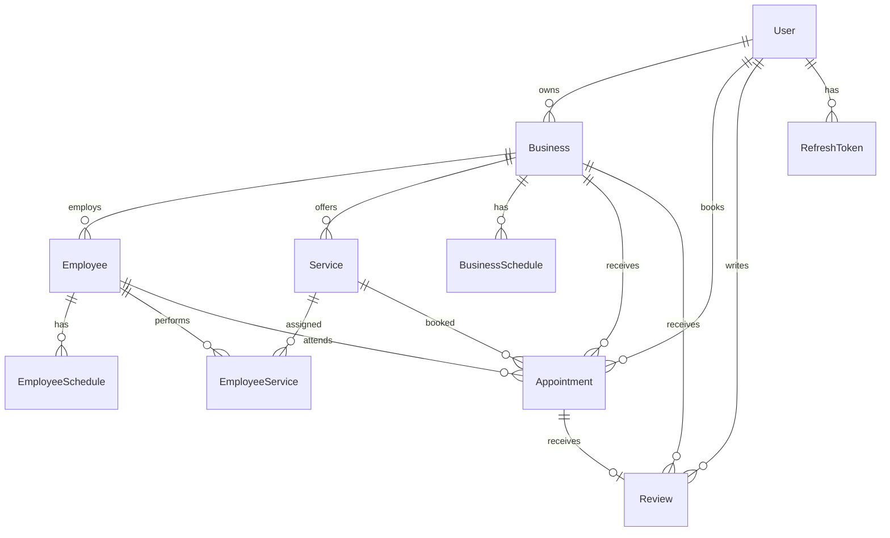

# BooklyPro

Plataforma SaaS full-stack de reservas para pequeños negocios.

BooklyPro permite a clientes descubrir negocios, consultar servicios y empleados, revisar disponibilidad en tiempo real, reservar citas y gestionar su historial. También incorpora autenticación, roles, reseñas y una base preparada para administración por parte de propietarios.

## Demo

Frontend:

https://booklypro-web-production.up.railway.app

API:

https://booklypro.up.railway.app

Health check:

https://booklypro.up.railway.app/api/health

Repositorio:

https://github.com/Viths3/BooklyPro

> Estado actual: MVP funcional en desarrollo.

---

## Características

### Cliente

- Registro e inicio de sesión.
- Sesiones con access token y refresh token.
- Catálogo público de negocios.
- Detalle de negocios.
- Consulta de servicios.
- Consulta de empleados.
- Consulta de reseñas.
- Disponibilidad por fecha, servicio y empleado.
- Flujo guiado de reserva.
- Creación de citas.
- Dashboard privado.
- Consulta de próximas citas e historial.
- Cancelación de citas.
- Reseñas después de completar una cita.

### Negocios

Backend preparado para:

- Crear y editar negocios.
- Desactivar negocios mediante soft delete.
- Administrar servicios.
- Activar y desactivar servicios.
- Administrar empleados.
- Asignar servicios a empleados.
- Configurar horarios semanales.
- Consultar citas de un negocio.
- Gestionar estados de citas.

El dashboard completo del propietario se encuentra entre las siguientes fases de desarrollo.

---

## Flujo principal

```text
Cliente
  ↓
Explora negocios
  ↓
Selecciona negocio
  ↓
Selecciona servicio
  ↓
Selecciona empleado
  ↓
Selecciona fecha
  ↓
Consulta disponibilidad
  ↓
Selecciona horario
  ↓
Inicia sesión si es necesario
  ↓
Confirma reserva
  ↓
Cita PENDING
  ↓
Dashboard del cliente
  ↓
Cancelación / historial / reseña
```

---

## Stack tecnológico

### Frontend

- React
- TypeScript
- Vite
- Tailwind CSS
- React Router
- TanStack Query
- React Hook Form
- Zod
- Vitest
- React Testing Library

### Backend

- Node.js
- Express
- TypeScript
- PostgreSQL
- Prisma ORM
- Zod
- bcrypt
- jsonwebtoken

### Infraestructura

- Railway
- PostgreSQL en Railway
- Docker Compose para desarrollo local
- GitHub Actions
- Git

---

## Arquitectura

El proyecto utiliza una estructura de monorepo:

```text
BooklyPro/
├── client/
│   ├── src/
│   │   ├── api/
│   │   ├── components/
│   │   ├── features/
│   │   │   ├── appointments/
│   │   │   ├── auth/
│   │   │   ├── booking/
│   │   │   └── businesses/
│   │   ├── layouts/
│   │   ├── lib/
│   │   ├── pages/
│   │   ├── routes/
│   │   └── test/
│   ├── package.json
│   └── vite.config.ts
│
├── server/
│   ├── prisma/
│   │   ├── migrations/
│   │   ├── schema.prisma
│   │   └── seed.ts
│   ├── src/
│   │   ├── config/
│   │   ├── controllers/
│   │   ├── middleware/
│   │   ├── repositories/
│   │   ├── routes/
│   │   ├── schemas/
│   │   ├── services/
│   │   ├── types/
│   │   └── utils/
│   ├── test/
│   ├── package.json
│   └── railway.json
│
├── docs/
├── docker-compose.yml
├── package.json
└── README.md
```

La aplicación mantiene separación por capas en backend:

```text
Routes
  ↓
Controllers
  ↓
Services
  ↓
Repositories
  ↓
Prisma
  ↓
PostgreSQL
```

El frontend está organizado principalmente por features.

---

## Modelo de datos

Entidades principales:

- User
- Business
- Employee
- Service
- EmployeeService
- BusinessSchedule
- EmployeeSchedule
- Appointment
- Review
- RefreshToken



---

## Roles

BooklyPro define tres roles:

```text
CUSTOMER
BUSINESS_OWNER
ADMIN
```

Actualmente el flujo principal implementado en frontend está centrado en `CUSTOMER`.

El backend ya contiene permisos y operaciones para propietarios.

---

## Estados de una cita

```text
PENDING
CONFIRMED
COMPLETED
CANCELLED
NO_SHOW
```

Transiciones permitidas:

```text
PENDING
├── CONFIRMED
└── CANCELLED

CONFIRMED
├── COMPLETED
├── CANCELLED
└── NO_SHOW
```

Los estados:

```text
COMPLETED
CANCELLED
NO_SHOW
```

son finales.

---

## Disponibilidad

La disponibilidad se calcula usando:

- negocio;
- servicio;
- empleado;
- fecha;
- horario del negocio;
- horario del empleado;
- duración del servicio;
- citas existentes;
- zona horaria del negocio.

Ejemplo:

```http
GET /api/availability?businessId=UUID&serviceId=UUID&employeeId=UUID&date=2026-10-15
```

Respuesta:

```json
{
  "data": {
    "date": "2026-10-15",
    "businessId": "UUID",
    "serviceId": "UUID",
    "employeeId": "UUID",
    "durationMinutes": 30,
    "slots": [
      {
        "startTime": "09:00",
        "endTime": "09:30"
      },
      {
        "startTime": "09:15",
        "endTime": "09:45"
      }
    ]
  }
}
```

Solo las citas:

```text
PENDING
CONFIRMED
```

bloquean disponibilidad.

---

## Protección contra reservas simultáneas

La disponibilidad visible en frontend no se considera una reserva.

El backend vuelve a validar el horario durante la creación de la cita.

PostgreSQL también protege contra solapamientos mediante una restricción de exclusión GiST.

Esto evita que dos peticiones concurrentes reserven el mismo empleado en horarios incompatibles.

---

## Zonas horarias

Cada negocio posee una zona horaria IANA.

Ejemplo:

```text
America/Guayaquil
```

Los horarios de apertura y trabajo se almacenan como horario local.

Las citas se almacenan como instantes absolutos.

BooklyPro utiliza manejo explícito de zona horaria para evitar errores producidos por offsets, cambios de día y DST.

---

## Autenticación

Endpoints principales:

```http
POST /api/auth/register
POST /api/auth/login
POST /api/auth/refresh
POST /api/auth/logout
GET  /api/auth/me
```

El sistema utiliza:

- JWT access token.
- JWT refresh token.
- Refresh token rotation.
- Familias de sesión.
- Revocación.
- Detección de reutilización de refresh token.
- bcrypt para contraseñas.

Los refresh tokens no se almacenan directamente en PostgreSQL.

Se almacena su hash SHA-256.

---

## Negocios

Endpoints principales:

```http
GET    /api/businesses
GET    /api/businesses/:id
GET    /api/businesses/me
POST   /api/businesses
PATCH  /api/businesses/:id
DELETE /api/businesses/:id
```

Características:

- listado público;
- búsqueda;
- paginación;
- propiedad por usuario;
- soft delete;
- promoción de CUSTOMER a BUSINESS_OWNER.

---

## Servicios

```http
GET    /api/businesses/:businessId/services
GET    /api/services/:id
GET    /api/businesses/:businessId/services/manage
POST   /api/businesses/:businessId/services
PATCH  /api/services/:id
DELETE /api/services/:id
```

Los precios usan `Decimal` para evitar problemas de precisión con números flotantes.

Ejemplo:

```json
{
  "price": "15.00"
}
```

---

## Empleados

```http
GET    /api/businesses/:businessId/employees
GET    /api/businesses/:businessId/employees/manage
GET    /api/employees/:id
POST   /api/businesses/:businessId/employees
PATCH  /api/employees/:id
DELETE /api/employees/:id
```

Asignación de servicios:

```http
GET    /api/employees/:id/services
POST   /api/employees/:id/services/:serviceId
DELETE /api/employees/:id/services/:serviceId
```

---

## Horarios

Horarios de negocio:

```http
GET   /api/businesses/:businessId/schedules
PUT   /api/businesses/:businessId/schedules
PATCH /api/businesses/:businessId/schedules/:dayOfWeek
```

Horarios de empleado:

```http
GET   /api/employees/:employeeId/schedules
PUT   /api/employees/:employeeId/schedules
PATCH /api/employees/:employeeId/schedules/:dayOfWeek
```

El backend comprueba que los horarios del empleado estén dentro del horario del negocio.

---

## Reservas

```http
POST  /api/appointments
GET   /api/appointments/me
GET   /api/appointments/:id
PATCH /api/appointments/:id/cancel
GET   /api/businesses/:businessId/appointments
PATCH /api/appointments/:id/status
```

Al crear una reserva, el backend:

1. Obtiene el cliente de la sesión.
2. Valida negocio, servicio y empleado.
3. Comprueba la asignación del servicio.
4. Comprueba horarios.
5. Revalida disponibilidad.
6. Calcula la hora final.
7. Guarda el precio del momento de la reserva.
8. Crea la cita como `PENDING`.

---

## Reseñas

```http
POST /api/appointments/:appointmentId/review
GET  /api/businesses/:businessId/reviews
GET  /api/reviews/:id
```

Reglas:

- solo citas `COMPLETED`;
- una reseña por cita;
- rating entero entre 1 y 5;
- comentario opcional;
- protección contra creación concurrente de duplicados.

Ejemplo:

```json
{
  "rating": 5,
  "comment": "Excelente atención"
}
```

---

## Frontend

Actualmente el frontend permite:

- landing page;
- registro;
- login;
- logout;
- sesión protegida;
- listado de negocios;
- detalle de negocio;
- consulta de servicios;
- consulta de empleados;
- visualización de reseñas;
- booking wizard;
- consulta de disponibilidad;
- creación de reservas;
- dashboard del cliente;
- listado de citas;
- detalle de cita;
- cancelación;
- creación de reseñas.

El frontend utiliza TanStack Query para manejar consultas, mutations, caché e invalidaciones.

---

## Flujo de reservas frontend

```text
/businesses/:businessId
        ↓
Reservar
        ↓
Servicio
        ↓
Empleado
        ↓
Fecha
        ↓
Horario
        ↓
Resumen
        ↓
Login si no existe sesión
        ↓
Confirmar
        ↓
PENDING
```

Si otro cliente ocupa el horario justo antes de confirmar, el frontend vuelve a consultar disponibilidad y solicita seleccionar otro slot.

---

## Dashboard del cliente

Rutas principales:

```text
/dashboard
/dashboard/appointments
/dashboard/appointments/:appointmentId
```

Permite:

- visualizar próxima cita;
- consultar citas;
- separar próximas citas e historial;
- filtrar por estado;
- cancelar citas;
- consultar detalle;
- publicar reseñas de citas completadas.

---

## API

Las respuestas siguen una convención uniforme.

### Recurso

```json
{
  "data": {}
}
```

### Lista

```json
{
  "data": []
}
```

### Paginación

```json
{
  "data": [],
  "pagination": {
    "page": 1,
    "limit": 20,
    "total": 50,
    "totalPages": 3
  }
}
```

### Error

```json
{
  "error": {
    "code": "ERROR_CODE",
    "message": "Human readable message"
  }
}
```

Errores de validación pueden incluir:

```json
{
  "error": {
    "code": "VALIDATION_ERROR",
    "message": "Validation failed",
    "details": [
      {
        "field": "email",
        "message": "Invalid email"
      }
    ]
  }
}
```

---

## Health check

Producción:

```http
GET https://booklypro.up.railway.app/api/health
```

Respuesta:

```json
{
  "data": {
    "status": "ok",
    "service": "booklypro-api",
    "database": "connected"
  }
}
```

---

## Deployment

BooklyPro está desplegado en Railway.

Arquitectura actual:

```text
Railway
├── BooklyPro API
│   └── Node.js / Express / Prisma
│
├── BooklyPro Web
│   └── React / Vite
│
└── PostgreSQL
```

Backend:

```text
https://booklypro.up.railway.app
```

Frontend:

```text
https://booklypro-web-production.up.railway.app
```

El backend utiliza:

```text
Root Directory: /server
Build: npm run build
Pre-deploy: npm run db:deploy
Start: npm start
Healthcheck: /api/health
```

El frontend utiliza:

```text
Root Directory: /client
Build: npm run build
```

La URL de la API se configura mediante:

```env
VITE_API_URL=https://booklypro.up.railway.app
```

---

## Desarrollo local

### Requisitos

- Node.js 22.13+
- npm
- Docker Desktop
- Docker Compose
- Git

Clonar:

```bash
git clone https://github.com/Viths3/BooklyPro.git
cd BooklyPro
```

Instalar:

```bash
npm install
```

Configurar backend:

```powershell
Copy-Item .env.example .env
Copy-Item server/.env.example server/.env
```

En Bash:

```bash
cp .env.example .env
cp server/.env.example server/.env
```

Generar secretos:

```bash
node -e "console.log(require('node:crypto').randomBytes(48).toString('hex'))"
```

Generar dos valores distintos para:

```env
JWT_ACCESS_SECRET=
JWT_REFRESH_SECRET=
```

---

## Base de datos local

Levantar PostgreSQL:

```bash
docker compose up -d
```

Aplicar migraciones:

```bash
cd server
npm run db:generate
npm run db:deploy
```

Ejecutar backend:

```bash
npm run dev
```

Disponible en:

```text
http://localhost:3000
```

---

## Frontend local

En otra terminal:

```bash
cd client
npm install
```

Crear:

```env
VITE_API_URL=http://localhost:3000
```

Ejecutar:

```bash
npm run dev
```

Disponible en:

```text
http://localhost:5173
```

---

## Ejecutar todo localmente

Terminal 1:

```bash
docker compose up -d
```

Terminal 2:

```bash
cd server
npm run dev
```

Terminal 3:

```bash
cd client
npm run dev
```

---

## Tests

### Frontend

```bash
cd client
npm run lint
npm run build
npm test
```

Actualmente el frontend incluye pruebas para:

- autenticación;
- sesiones;
- rutas;
- formularios;
- booking;
- disponibilidad;
- dashboard del cliente;
- cancelaciones;
- reseñas.

### Backend

```bash
cd server
npm run build
npm test
```

Las suites de integración utilizan PostgreSQL real en bases temporales aisladas.

También existen pruebas específicas de:

- autenticación;
- negocios;
- servicios;
- empleados;
- horarios;
- disponibilidad;
- appointments;
- reviews;
- concurrencia;
- restricciones SQL.

---

## Seguridad

Se han implementado, entre otras medidas:

- hashing bcrypt de contraseñas;
- JWT access y refresh separados;
- refresh token rotation;
- detección de replay;
- almacenamiento de hashes de refresh tokens;
- validación estricta con Zod;
- consultas parametrizadas mediante Prisma;
- autorización por propiedad;
- soft delete;
- rate limiting;
- Helmet;
- CORS configurable;
- respuestas de error sin detalles internos;
- protección de reservas concurrentes en PostgreSQL.

---

## Git workflow

El proyecto utiliza:

```text
main
develop
feature/*
```

Flujo:

```bash
git switch develop
git pull origin develop

git switch -c feature/nueva-feature

# desarrollo

git push -u origin feature/nueva-feature

git switch develop
git merge --no-ff feature/nueva-feature
git push origin develop
```

Las versiones estables se promueven de `develop` a `main`.

---

## Roadmap

Próximas fases previstas:

- Dashboard completo para propietarios.
- Gestión frontend de negocios.
- Gestión frontend de servicios.
- Gestión frontend de empleados.
- Editor visual de horarios.
- Gestión de citas para propietarios.
- Mejoras visuales y de UX.
- Notificaciones.
- Métricas del negocio.
- Release estable v1.0.0.

---

## Estado del proyecto

Actualmente BooklyPro cuenta con un MVP funcional que incluye:

```text
Backend completo de reservas
+
Frontend público
+
Autenticación
+
Booking
+
Dashboard del cliente
+
Reseñas
+
PostgreSQL
+
Deployment en Railway
```

El desarrollo continúa principalmente sobre las herramientas administrativas del propietario.

---

## Autor

**Juan Guamán**

Software Engineer

Ecuador

GitHub:

https://github.com/Viths3